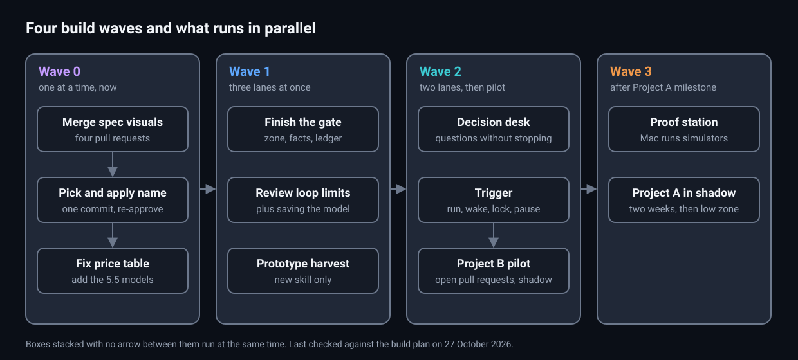

# Build plan: getting the factory into cstack

**Parked on 2026-10-29 by the owner** (see `LATER.md`): cstack stays a portable skill set, and only `factory tokens` is supported.

Status: 2026-10-27. Written for the owner, the person who approves specs and merges cstack. It lists every piece of the [factory design](2026-10-25-factory-design.md), what state each piece is in, and which pieces can be built at the same time.

## 1. Where each piece stands

"Specced" means an OpenSpec change exists: a folder in `openspec/changes/` with scenarios, a design and tasks. "Approved" means the owner signed it off, recorded in its `approval.json`.

| Piece | Specced | Approved | Built | What is left |
|---|---|---|---|---|
| `add-spec-visuals`: worked examples and dated diagrams | Yes | Yes | Yes. 4 stacked branches `build/spec-visuals-*`, all tests pass, spec compliance "Proven" | Open the 4 pull requests and merge them |
| `add-factory-gate`: usage report, budget meter, risk zone, shadow gate | Yes | Yes | Half. Groups 1–4 on the `feat/factory-*` branches: locked tests, plugin, settings, usage report, budget meter, Breaker routing | Group 5 (zone, facts, gate and ledger), 6.0 (`pr-review` saves the Codex model), 6.1 docs, 6.2 a run on real pull requests. Also: the price table has no 5.5 models, so dollar figures are incomplete |
| `add-decision-desk`: questions answered without stopping | Yes | Yes | No | All of it |
| Name and command renames | No | No | — | The owner picks the name. `rivet` is proposed. Commands become `run`, `wake`, `usage`, `risk`, `ask`, `pause` |
| `add-factory-trigger`: `run`, `wake`, a lock per change, `pause`, a run record, the morning report | No | No | No | Spec, approval, build |
| `add-review-convergence`: review-loop limits, a pre-existing tag, an answer recorded for each finding, `REVIEW.md` read from trunk, a security lane, a "How to revert" line | No | No | No | Spec, approval, build |
| `add-prototype-harvest`: Project B's prototype-to-spec steps, made generic | No | No | No | Spec, approval, build |
| Proof station: one Mac runs live proof on simulators for builders on other machines | No | No | No | Spec, approval, build. Needed only when Project A starts |
| Project A setup, then 2 weeks in shadow | No | No | No | After Project A's database milestone. Project-side pull requests, not cstack |
| Project B pilot: its open pull requests through the gate in shadow | No | No | No | After the gate and the trigger |

## 2. The rule for building in parallel

Two pieces are built at the same time only when both are true:

- **They share no files.** Each task lists the files it changes after "Touches:", so this can be checked.
- **Neither needs the other's output.**

One shared file is allowed: the `factory.mjs` command list. Each new command lives in its own file, and registering it is a one-line edit that the coordinator merges.

## 3. The order: four waves

Notice that wave 1 has three lanes at once, and the name change comes first. Renaming gets more expensive with every slice built under the old name. Made and last checked on 27 October 2026 (see `diagrams/diagrams.json`).

**Wave 0, one at a time, now:**

1. Open and merge the `add-spec-visuals` stack.
2. Pick the name. Rename everything in one commit, and record approval again for the two specs whose text changes.
3. Add the 5.5 models to the price table.

**Wave 1, three lanes at once:**

| Lane | Work | Touches |
|---|---|---|
| A. Factory core | Gate group 5, 6.1 and 6.2 | `plugins/factory/**` |
| B. Review | `add-review-convergence`, plus gate task 6.0, moved here because it edits the same skill | `plugins/verify/skills/pr-review/**`, `plugins/verify/scripts/record-review.mjs`, `plugins/verify/scripts/verdict.mjs` |
| C. Spec intake | `add-prototype-harvest` | A new skill folder only |

Lanes B and C start with writing their specs. They can be drafted today while lane A builds.

**Wave 2, two lanes at once, after lane A:**

| Lane | Work | Needs |
|---|---|---|
| D. Trigger | `add-factory-trigger` | The gate's settings and the budget meter |
| E. Decisions | `add-decision-desk` | The gate's settings and the budget route |

Then the Project B pilot: its open pull requests run through the gate in shadow, and the morning report shows the results.

**Wave 3, after Project A's database milestone:**

- the proof station;
- Project A's settings and its zone script, written from its guardrails file;
- 2 weeks in shadow;
- then the low zone switches on, if it has earned it.

## 4. Decisions the owner still owes

1. The name.
2. Whether the `add-spec-visuals` pull requests may open as drafts with the cold reader overridden. Their bodies pass the plain checker; the cold reader keeps asking about the other pull requests in the stack.
3. Approval of the three new specs once drafted: trigger, review convergence, prototype harvest.
4. The date of Project A's database milestone.

## 5. Notes

- The Codex plan is at its weekly limit until 28 October 2026, 12:13 AM. Until then, the Breaker review runs on a fresh Opus run, as the budget rule says.
- Nothing here needs a desktop app. Every run starts with `claude -p`.
