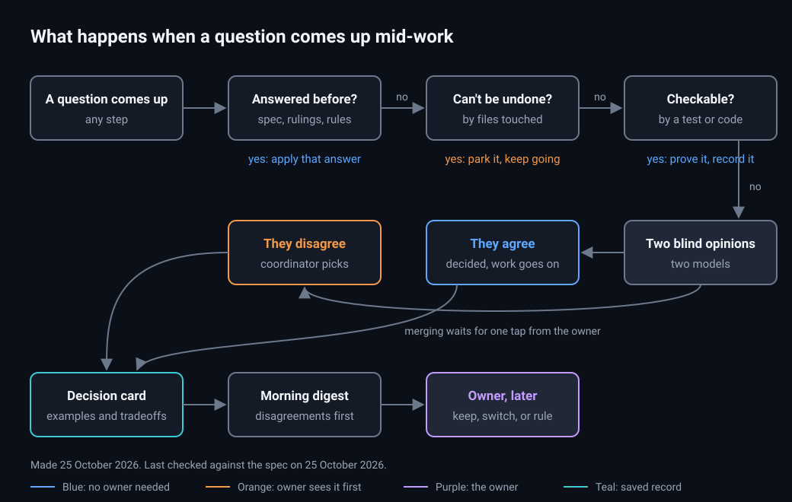

# Design: add-decision-desk

## Picture



Notice that only two paths reach the owner before merging: a question that can't be undone, and a disagreement between two models. Everything else is decided and shown later. Made and last checked on 25 October 2026 (see `diagrams/diagrams.json`).

## Who decides what

| Step | Decided by | Cost | Blocks |
|---|---|---|---|
| Answered before | Script: finds the cited ruling, rule or spec text | None | Nothing |
| Can't be undone | Script: paths and tags | None | That question only. The builder takes another slice |
| Can be checked | Script runs the named command | One command | Nothing |
| Two blind opinions | Builder model plus a second model of another family when the budget allows | One short run | Nothing |
| Contested | Coordinator, with both sides' reasons | One short run | The merge of affected pull requests, until the owner answers |

The builder never decides alone. In the first three steps, a script decides. In the fourth, two models decide independently.

## The question file

The builder writes `decisions/<id>.question.json`:

```json
{
  "id": "d-0012",
  "question": "How many rows per page on the reminders list?",
  "touches": ["app/reminders/page.tsx"],
  "tags": ["ui"],
  "usersSeeIt": true,
  "cites": [],
  "check": null,
  "options": [
    { "label": "A", "text": "25 rows", "tradeoffs": "Matches other lists; more page changes for big clinics", "screenshot": "evidence/d-0012-a.png" },
    { "label": "B", "text": "50 rows", "tradeoffs": "Fewer page changes; slower first load on old phones", "screenshot": "evidence/d-0012-b.png" }
  ],
  "builderPick": "A",
  "builderWhy": "Matches the patients and recordings lists"
}
```

`factory decide` reads it, routes it, and writes `decisions/d-0012.md`, the card a person reads. The question file stays as the record of what the builder proposed.

## The blind brief

The script, not the builder, writes the second model's brief:

- the question;
- the context paths;
- the options, relabelled with random letters in random order;
- each option's tradeoffs.

The brief asks for one pick and three sentences of reasons. Because the builder never writes the brief, it can't lead the second model.

## Rulings and rules

- **A ruling** is the owner's `keep`. It is one line in `<git common dir>/factory/rulings.jsonl`, with the date and the card it came from. It sits next to the gate's record and is shared by every worktree.
- **A rule** is a ruling the owner wants everywhere. It becomes a line in the project's `objectives.md`, through its own pull request. That pull request changes the factory's rules, so the owner always reviews it.

## Reuse

| Piece | Already exists | Extended or created |
|---|---|---|
| Second-model choice | `factory budget`'s Breaker route | Reused |
| Paths that can't be undone | The gate's `neverMerge` and `high` settings | Reused |
| Screenshots | The Behavior lane's evidence runs, or the prototype | Reused |
| Parking questions with a default | pstack's `gates.md` idea | Design borrowed. Here the default must also pass the blind second opinion |
| Answer-later batches | pstack's buffer-then-read pattern, and the morning report | The digest is a section of the morning report |
| Question path, cards, rulings | Nothing | Created |

## Decisions

- 2026-10-25: The second opinion is blind and, when budget allows, from another model family. Agreement between independent picks is the signal, following poteto's rule that agreement between models is high-signal.
- 2026-10-25: A disagreement never stops building. It only holds the merge of the pull requests it affects.
- 2026-10-25: Three unanswered disagreements in one change pause new slices for it, because that many means the spec is unclear.
- 2026-10-25: Visible choices need a screenshot of every option, so the owner can judge from the digest without running anything.

## Open questions

1. Is three unanswered disagreements the right point to pause a change? Recommended: start at three, and read the first month's digests to tune it.
