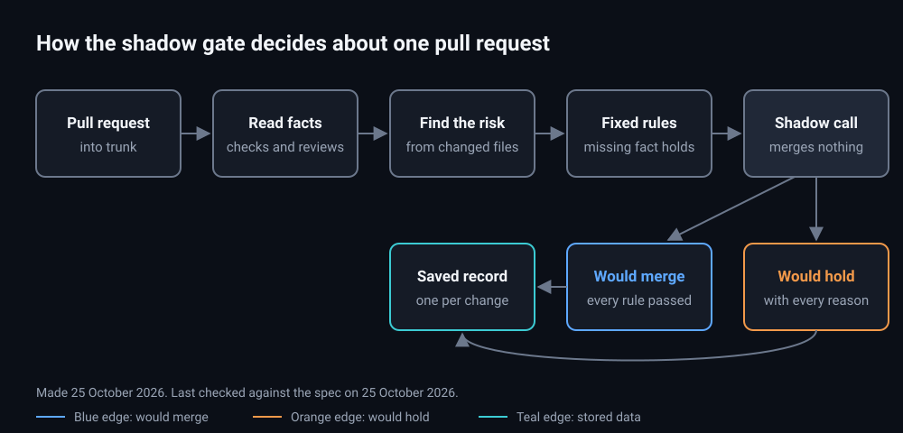

# Design: add-factory-gate

## Picture



Notice that every path ends in a saved record, and none ends in a merge. Made and last checked on 25 October 2026 (see `diagrams/diagrams.json`).

## Layout

```
plugins/factory/
  .claude-plugin/plugin.json
  scripts/factory.mjs            one command: gate | budget | tokens
  scripts/lib/settings.mjs       reads and checks the factory block in .claude/verify.json
  scripts/lib/facts.mjs          collects facts about a pull request (gh, git, verify's records)
  scripts/lib/zone.mjs           works out the zone
  scripts/lib/gate.mjs           turns facts into a call and its reasons (no input or output)
  scripts/lib/ledger.mjs         writes one record per pull request and head commit
  scripts/lib/budget.mjs         readings, pace, modes, the Breaker's route
  scripts/lib/tokens.mjs         transcript totals and prices
  data/prices.json               dollars per million tokens, dated, with where each number came from
  skills/factory/SKILL.md        when to run each command and how to read its output
  tests/
```

**The gate keeps its decision apart from reading the world.** `facts.mjs` collects a plain object of facts, and `gate.mjs` turns that object into a call. Most tests then feed facts straight to `gate.mjs`. Only a few tests need a real git repository and a stand-in for `gh`.

## Settings

The new block in `.claude/verify.json`:

```json
"factory": {
  "allowedBases": ["dev"],
  "zone": { "command": null, "high": [], "standard": [], "low": [] },
  "neverMerge": [".github/**", "openspec/**"],
  "runtimeSurface": [],
  "flagsRequired": false,
  "sizeLimit": 400,
  "notCounted": ["**/*.test.*", "**/__tests__/**", "**/*.lock", "**/package-lock.json", "**/pnpm-lock.yaml", "**/yarn.lock"],
  "merge": { "low": "shadow", "standard": "shadow", "high": "off" }
}
```

- `allowedBases` defaults to the file's existing `integrationBranch`.
- `neverMerge` always includes `.github/**`, `openspec/**`, and the settings file itself, even if a project leaves them out.

## How the gate reads a pull request

1. **Pull request data.** `gh pr view` returns:
   - the base and the head commit;
   - whether it's a draft;
   - the description and the changed files;
   - the check results.

   `gh api graphql` returns whether every review thread is resolved.
2. **Commits.** The gate fetches the base and head commits into the project's main checkout without checking them out. The pull request's code is read as data and never run.
3. **The zone command runs in the main checkout,** and only when that checkout sits on the trunk commit with no local changes. Otherwise the gate holds with a reason. This is the same protection Project B's owner check uses: a pull request can't change the tool that scores it.
4. **Verdicts** come from `verify`'s `verdict.mjs check --json`. Compliance reports and evidence runs are found by looking in `.verify/runs` in every worktree that `git worktree list` shows.
5. **Finding the `verify` scripts** works in this order:
   1. the `CSTACK_VERIFY` environment variable;
   2. the sibling folder `../verify` when running from the cstack repository;
   3. the newest installed copy under `~/.claude*/plugins/cache/cstack/verify/`.

   If none is found, the gate holds with "verify plugin not found".

## Budget readings

**Claude.** Each account folder's `.claude.json` holds `cachedUsageUtilization`. It has:

- `fetchedAtMs`;
- `five_hour` and `seven_day`, each with a `utilization` and a `resets_at`.

The reading only refreshes while a session on that account is open, so the 12-hour staleness rule matters.

**Codex.** Codex session logs hold `token_count` events with `rate_limits.primary` (the 5-hour window) and `rate_limits.secondary` (the weekly window). Each one has a `used_percent` and a `resets_at`. The newest event wins.

The budget command never calls a network service.

## Prices

`data/prices.json` holds, for each model:

- input, output and cache-read dollars per million tokens;
- the date the prices were checked.

Cache writes are priced at 1.25 times input for the 5-minute cache and 2 times input for the 1-hour cache. Those two multipliers are recorded in the file as an unconfirmed assumption. Codex totals are reported in tokens only, because a subscription doesn't bill Codex per token.

## Reuse

| Piece | Already exists | Extended or created |
|---|---|---|
| Review verdicts per change, carried over by patch-id | `verify` `verdict.mjs` | Reused through its command line |
| Live evidence check | `verify` `evidence.mjs check` | Reused through its command line |
| Compliance report | `verify` `spec-compliance.mjs` writes `compliance.json` | Read only |
| Settings file | `.claude/verify.json` and `docs/project-settings.md` | Extended with a `factory` block |
| Shared git folder for state | `verify` keeps verdicts in `<git common dir>/verify/` | Same pattern: `<git common dir>/factory/` |
| Usage readings | The orchestrate design's pace meter, never built | Created here as `factory budget` |
| Token scan | The one-off scan run on 2026-10-25 | Created here as `factory tokens` |
| Zone from the diff | Project B's own zone script | Called through `zone.command`. The fallback is created here |

## Decisions

- 2026-10-25: The gate merges nothing in this change. A `merge` value of `on` is refused.
- 2026-10-25: The record of calls goes into the shared git folder, never into pull request labels or comments.
- 2026-10-25: Budgets are in percent of each subscription's limit. Dollars only describe where usage went.
- 2026-10-25: `factory` is its own plugin. It reaches `verify` through `verify`'s command-line scripts, never by importing its files, so the two can be installed and updated separately.

## Open questions

1. **Project A's zone patterns.** Task 6.1 drafts them from Project A's guardrails document. The owner approves them before they go into Project A's settings file.

## Candidates from the pilot evidence (not decisions)

These come from [the Project A loop pilot](../../../docs/specs/2026-10-27-pilot-evidence-mobileapp-v2.md). They are for the owner to accept, change or drop. None is approved, and no spec text under `specs/` changes, so `approval.json` still matches. Each would need its own spec edit and approval before anyone builds it.

1. **Measure test results instead of guessing from paths.** A test-only auto-merge rule built on file names never converged in four review rounds (evidence section 7). Candidate: before a pull request can ever be marked `would-merge`, the gate runs the changed tests on the base and on the head and compares them. A test that passed on base must still pass. A removed or skipped test holds. This would sit beside `notCounted` and the zone, which are path guesses. Open question: does the gate run tests itself, or read a record that `verify` writes?
2. **A docs-only path.** A pre-push gate with no docs exemption cost four docs pull requests either two votes each or an owner visit (evidence section 6). Candidate: a diff where every path is under `docs/`, or is Markdown outside `.claude/`, gets its own zone with a lighter check (links resolve, writing rules pass, no review votes). `neverMerge` still covers `openspec/**` and `.github/**`, and files that change how agents behave stay gated.
3. **Votes are one Claude QA lens and one cross-provider lens.** The pilot's two-voter shape found defects the other lens missed in both directions (evidence section 4). The gate already requires a `codex` verdict with an OpenAI model. Candidate: also require the other verdict to come from a Claude lens, and record the lens name in the ledger so a later review can count findings per lens.
4. **Two failed rounds means simplify or park.** Non-converging loops cost about 3M to 5M tokens in the pilot (evidence section 3). Candidate: the ledger counts review rounds per change, and a third round on the same design makes the gate hold with `two rounds used, simplify or park` until the owner or a changed design resets the count.
5. **A mutation check on guard files.** `verify` 0.5.0's `breakGuard` is the automated form of the most repeated review finding. Candidate: for paths in the `high` zone or tagged GUARDS in the spec, the gate reads the `breakGuard` result for the head commit as a required fact.
6. **Shared tracker files are not a merge hazard.** With one status file per task, the gate should not treat a conflict on `tasks.md` as normal. Candidate: a hold reason, `tasks.md edited by a code pull request`, in line with the one-writer-per-file principle.
7. **Base branches beyond one trunk.** A fixed list of base branches sent three pilot slices to wrong-base rounds. Open question: should `allowedBases` accept patterns such as `feature/*`, with the merge-base found from the pull request's own `baseRefName`?
8. **Facts must come from the head commit, not the merge ref.** CI that checks out the pull request's merge ref showed false reds when the pull request merged mid-run (evidence section 9). Candidate: the gate reads checks only for the exact head SHA and says so in the record.

## Candidates for the meters (not decisions)

1. **Usage meters count subagents and per-voter cost.** The pilot's costs were agent-reported estimates because nothing summed subagent tokens (evidence sections 2 and 9). Candidate: `factory tokens` reports, per pull request, the total across the orchestrator, builder and each reviewer separately, so a round's cost shows per voter.
2. **Fresh-agent setup cost is its own line.** About 100k to 200k tokens per fresh agent went to reading instructions and installing before any work. Candidate: `factory tokens` reports the tokens before an agent's first edit, so a team can see whether resuming an agent is cheaper than starting one.
