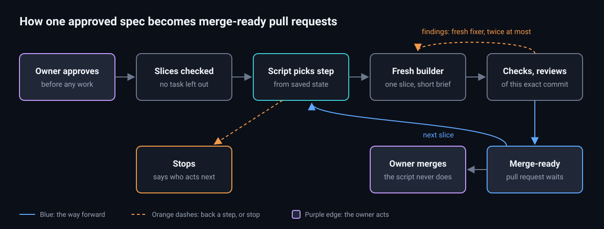

# Design: add-factory-run

## Picture



Notice that the script decides every step and the agents only do the work, and that every stop names who acts next. Made and last checked on 29 October 2026 (see `diagrams/diagrams.json`).

## Depends on

- **`add-factory-gate` group 2** (#32, the plugin and its settings). This change adds commands to `plugins/factory/scripts/factory.mjs` and a `run` block to the same settings. It builds on that branch, or on the trunk once #32 is merged.
- **`verify`** as it is on the trunk: `review-prep.mjs` for packets, and `verdict.mjs check` for patch-id verdicts.
- **`factory tokens`** (#33) for the `tokens` metrics field. Until #33 is merged, the field is `unknown`.

It does not depend on the gate's zone or ledger, or on the decision desk. When those land, `factory next` can read them. Until then the owner is the gate.

## Layout

```
plugins/factory/
  scripts/factory.mjs              adds: plan | next | record | brief | note | status | pause | patterns
  scripts/lib/run/plan.mjs         reads tasks.md, the specs and slices.json; returns problems or a plan
  scripts/lib/run/state.mjs        reads plan.json + events.jsonl into one object; the only reader
  scripts/lib/run/next.mjs         state + facts -> one action (no input or output, like gate.mjs)
  scripts/lib/run/facts.mjs        git heads, patch-ids, verdicts (verify), pull request state (gh)
  scripts/lib/run/record.mjs       appends events and metrics; refuses unknown fields
  scripts/lib/run/brief.mjs        writes briefs; matches pattern records by path
  scripts/lib/run/status.mjs       regenerates STATUS.md
  scripts/lib/run/lock.mjs
  scripts/lib/patterns.mjs         pattern record lint
  skills/implement-spec/SKILL.md   the coordinator loop, for every harness
  commands/implement-spec.md       /implement-spec <change> [--slice <id>]
  briefs/builder.md fixer.md reviewer.md planner.md
  tests/run-*.test.mjs
```

**The decision is kept apart from reading the world,** as in the gate. `next.mjs` is a pure function from a state object and a facts object to one action. Most tests call it directly with fixtures. A few use a real temporary git repository and a stand-in `gh`.

## Settings

A new `run` block inside the `factory` block of `.claude/verify.json`:

```json
"run": {
  "slicePlanApproval": "owner",
  "builderModel": "opus",
  "reviewLanes": ["claims-auditor", "codex"],
  "maxFixRounds": 2,
  "maxOpenStack": 5,
  "lockMinutes": 90,
  "briefMaxLines": 80,
  "checks": ["<from the project's verify.json, if set>"],
  "integrationChecks": []
}
```

`reviewLanes` defaults to the lanes `verify:pr-review` already requires in the project, so this change cannot weaken them. A project may add lanes here, but may not remove required ones.

## The slice plan

`slices.json` in the change folder, written by the planner brief (Opus) from `tasks.md` and the specs:

```json
{
  "change": "add-reminders",
  "slices": [
    {
      "id": "1",
      "outcome": "Owners can create a reminder for a contact; it is saved and listed",
      "scenarios": ["reminder-is-created", "reminder-is-listed"],
      "tasks": ["1.1", "2.1"],
      "dependsOn": [],
      "touches": ["packages/convex/reminders/**", "apps/web/app/reminders/**"],
      "verify": ["pnpm lint", "pnpm typecheck", "pnpm vitest run reminders"],
      "integration": "Contacts list still loads with reminders present",
      "release": "Flag reminders.enabled stays off"
    }
  ]
}
```

The planner follows the factory design's [slicing rules](../../../docs/specs/2026-10-25-factory-design.md#8-slicing):

- cut vertically, not by layer;
- about 300 changed lines of non-test code;
- fits one fresh builder session;
- tidy-ups that make the feature easy to add go first.

The planner must not split a contract that can't be split. A schema and its only reader, for example, stay in one slice. It says so in the slice's `outcome`.

**Why a model writes the plan and a script checks it.** Grouping tasks well is judgment. Losing a task, a scenario or a dependency is a mechanical failure, and the script catches it every time.

## The coordinator loop

`/implement-spec <change> [--slice <id>]` loads the `implement-spec` skill. The loop is the same in every harness:

1. Run `factory next <change>`. Read only its JSON and `STATUS.md`.
2. Carry out the action:
   - `build` / `fix`: start one fresh builder with the brief path and the worktree the action names.
   - `check`: run the commands. The log goes to the `checks/` file. Only the summary line and the failures come back.
   - `review`: run `verify:pr-review` with the packet and brief. Each lane is independent, and the lanes run at the same time where the harness allows.
   - `integrate`: run the integration checks and spec compliance.
   - `wait`: stop. Report the reason and the next person who acts.
   - `done`: stop. Report the pull requests that are ready.
3. Run `factory record` with the result, the head and the evidence path.
4. Go back to 1.

How a builder starts depends on the harness. The skill lists all three ways, and the action JSON is the same for each:

| Harness | How the builder starts |
|---|---|
| T3 Code | `delegate_task`, with `isolation: "worktree"` |
| Claude Code | the Agent tool, with worktree isolation |
| Terminal | `claude -p` with the brief, in the worktree |

**The coordinator hands off instead of growing.** Past about 60k tokens of its own context, it runs `factory note` for anything it learned, ends, and a fresh session continues from `STATUS.md`. Fix rounds always use a fresh builder. This is an instruction in the skill. The script can't check a context size, so it isn't a gate.

## Builder model

The factory design's [layout](../../../docs/specs/2026-10-25-factory-design.md#6-layout) says builders run on Sonnet by default. The pilot evidence supports that, but only weakly: 4 Sonnet slices against several Opus slices of unequal size.

The owner's current rule (the delivery-efficiency pilot, October 2026) is Opus for planning, building and review until there is comparable evidence. So:

- `builderModel` defaults to `opus`;
- every metrics entry records the model that ran;
- switching a project to `sonnet` is a one-line settings change, made by the owner after comparing like-for-like slices in `metrics.jsonl`.

## Pattern records

```markdown
---
name: org-boundary
paths: ["packages/convex/**"]
ref: main
---
## When to use it
## Canonical code
## Canonical tests
## Invariants
## Known exceptions
## Automated checks
## Needs a reviewer
```

Records live in each project, not in cstack, because the exemplars are project code. The first records come from the pattern surveys of Project A and Project B (29 October 2026). The owner picks which candidates become canonical. A record is linked into a brief only by path match, so a builder never gets every record.

A record's "Automated checks" section names gates that exist. Proposed gates are listed as proposed. A gate is added to a project only after it has caught a real bad case and accepted the valid ones. Until then it runs in advisory mode.

## Metrics

`metrics.jsonl` is one shared file per repository, under the git common directory, so it is never committed. `factory tokens` and the morning report read it later. Session IDs come from:

- `CLAUDE_SESSION_ID` when it is set;
- the T3 Code thread ID when the coordinator passes `--session`;
- otherwise `unknown`.

## What was considered and not done

- **Matt Pocock's `implement-spec` as is.** Its ideas are kept:
  - a task graph;
  - file references in place of conversation;
  - worktrees for builders.

  Not kept:
  - **one integration branch per spec.** The gate needs one outcome per merge (see the factory design's cross-review);
  - **agent-driven scheduling and progress tracking.** Those are the parts that lost state in the pilot.
- **Parallel builders.** Deferred. The pilot's cost came from rework, not from waiting. One builder at a time keeps the first version easy to check. `next.mjs` already knows which slices are independent, so parallel work is a later setting.
- **Ticking `tasks.md`.** It caused the pilot's merge conflicts. Progress lives in state.

## Open questions

1. Should `slicePlanApproval` default to `"reviewer"` (an independent Opus review of the plan) for Project B, and stay `"owner"` for Project A? Recommended: `"owner"` for both until the first two plans have run.
