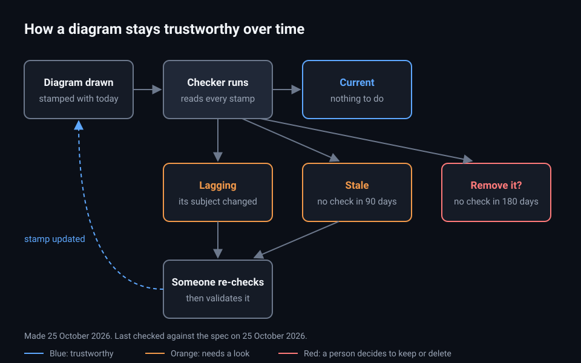

# Design: add-spec-visuals

## Picture

Notice two things. Only a person moves a diagram back to "current", by re-checking it. And nothing is ever deleted without a person deciding. Made and last checked on 25 October 2026 (see `diagrams/diagrams.json`).

## Where each piece lives

| Piece | Lives in | Why there |
|---|---|---|
| The rules: an example on every scenario, a diagram in every change | `openspec/config.yaml` | cstack already ships its OpenSpec rules to every project from here |
| The example check | `verify`'s `plan.mjs`, run by `verify-plan` | That's where scenarios are already read and checked |
| Stamps and the freshness check | `plain`'s new `diagram-age.mjs` | `plain` owns diagrams and their checker |
| The two age limits | `.claude/plain.json`: `diagramMaxAgeDays` (90), `diagramRemoveAfterDays` (180) | Each project already keeps `plain`'s settings there |

## How "lagging" is found

For each entry, the checker runs `git log --since=<lastValidated> --format=%cs -- <each depicts pattern>`. The newest commit date it finds is the "changed on" date in the report. When nothing comes back, the diagram isn't lagging. The check never reads file contents, so it is fast across a whole repository.

## The visible date

The picture carries one line of muted words: "Made <date>. Last checked against <what> on <date>." Plain-English rules hold commit IDs in pictures, which is why the line uses written dates. `diagram-age` reads the "on <day> <month> <year>" at the end of that line and compares it with `lastValidated`.

## Reuse

| Piece | Already exists | Extended or created |
|---|---|---|
| Diagram drawing and checker | `plain`'s `to-diagram` and `diagram-check.mjs` | Reused. `--validate` runs the checker first |
| Scenario reading | `verify`'s `checkScenarios` in `plan.mjs` | Extended with the example rule |
| "Only new things hold" | `verify-plan --since` | Reused for examples |
| Stamp files | Nothing | Created: `diagrams.json` |
| Freshness check | Nothing | Created: `diagram-age.mjs` |

## Decisions

- 2026-10-25: Dates, not commit IDs, in the picture, because they are readable at a glance and pass the plain-English rules.
- 2026-10-25: 90 days to "stale" and 180 days to "remove?", changeable per project.
- 2026-10-25: Lagging, stale and remove? are reported, never blocking. Only a missing or mismatched stamp fails the check.
- 2026-10-25: The `add-factory-gate` change already follows these rules, as the first example.

## Open questions

1. Should the factory's morning report list lagging and stale diagrams once a week? Recommended: yes, once the morning report exists.
